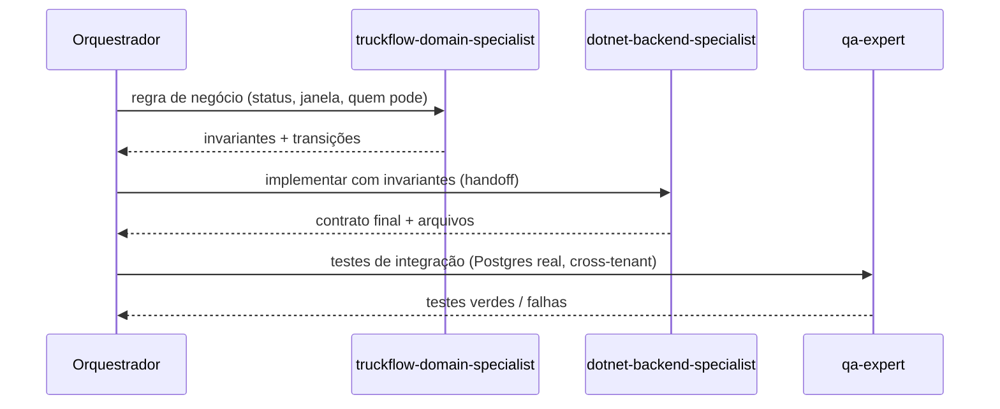
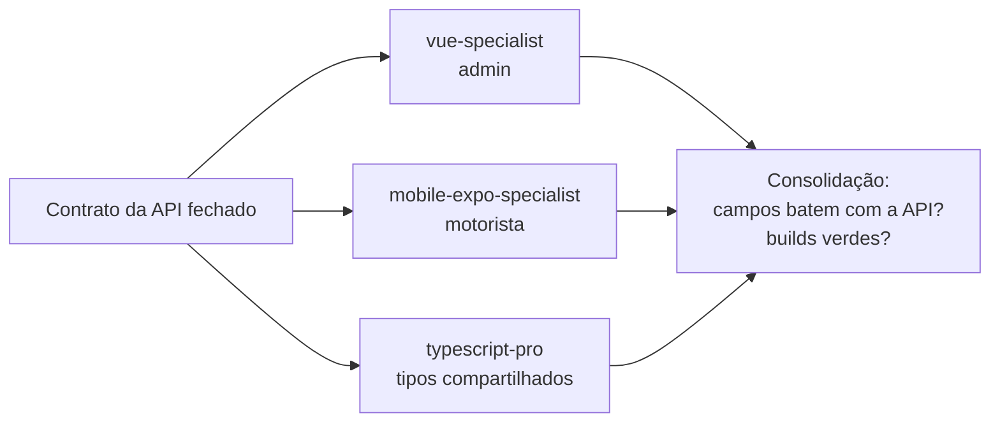
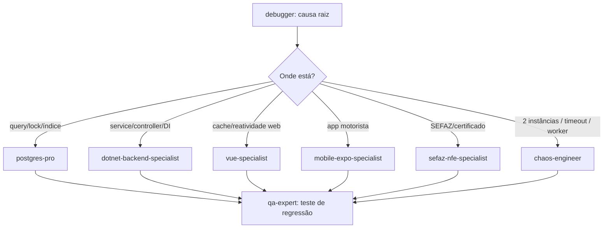
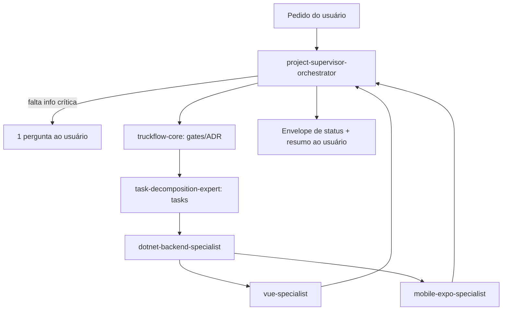
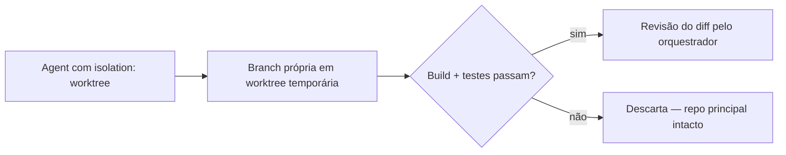

# Fluxos de orquestração

Três formas básicas — e a regra que governa todas: **contrato e dados primeiro, clientes depois**.

## 1. Sequencial

Cada etapa depende da saída da anterior. Use quando há dependência de contrato.

Repasse **resumos** (contrato, arquivos, pendências), não transcripts.

## 2. Paralelo (fan-out / fan-in)

Etapas independentes na **mesma mensagem** (várias chamadas Agent num bloco). Use para repos diferentes depois do contrato fechado, ou para pesquisas independentes.

Regras:
- Nenhum arquivo editado por dois agentes simultâneos.
- Se `typescript-pro` e `vue-specialist` mexem nos mesmos `*.types.ts`, serialize-os.
- Exploração read-only pode ser paralela sem restrição.

## 3. Condicional

Ramos dependem do achado de uma etapa.

## 4. Hierárquico (supervisor)

Para épicos, o `project-supervisor-orchestrator` decide a sequência e delega; especialistas não chamam outros especialistas (exceto `fullstack-developer`, que pode fazer fan-out por repo).

## 5. Isolado (worktree)

Para refactor amplo/arriscado (ex.: unificar `*Response` vs `*ResponseDto`, mover interfaces de repositório para Domain, trocar envelope de erro por ProblemDetails):

## Escolha rápida

| Situação | Fluxo |
|---|---|
| Front depende de endpoint novo | Sequencial (API → front) |
| Admin e mobile consomem o mesmo endpoint pronto | Paralelo |
| Não sei onde está o bug | Condicional a partir do `debugger` |
| Épico com 10+ tasks | Hierárquico |
| Refactor transversal | Isolado em worktree |
