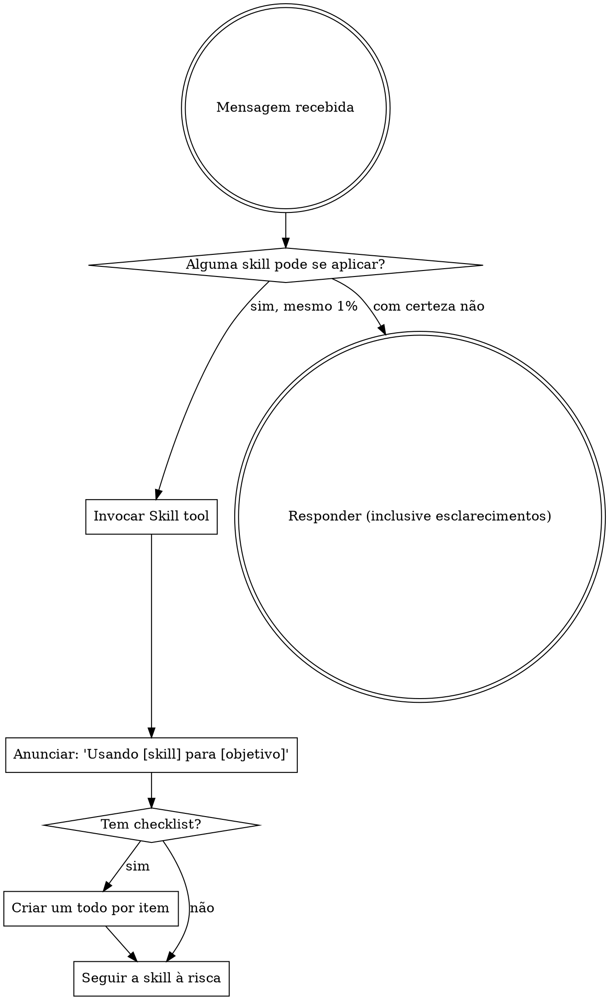

<EXTREMELY-IMPORTANT>
Se houver mesmo 1% de chance de uma skill se aplicar ao que você está fazendo, você PRECISA ler a skill.

SE UMA SKILL SE APLICA À SUA TAREFA, VOCÊ NÃO TEM ESCOLHA. USE-A.

Não é negociável. Não é opcional. Não racionalize para fugir disso.
</EXTREMELY-IMPORTANT>

# Usando skills no TruckFlow

## A regra

**Cheque as skills ANTES DE QUALQUER RESPOSTA.** Inclusive perguntas de esclarecimento. 1% de chance já significa invocar a Skill tool primeiro.

## Mapa rápido: tarefa → skill / agente

| Tarefa | Skill | Agente |
|---|---|---|
| Endpoint, service, DTO, exceção, DI no .NET | `dotnet-best-practices` | `dotnet-backend-specialist` |
| Migration, índice, query lenta, lock, schema PG | `postgres-best-practices` | `postgres-pro` |
| Tela/feature no admin Vue (types → service → queries → hooks → componentes → view) | `senior-frontend`, `vue-best-practices` | `vue-specialist` / `frontend-developer` |
| Rotas, lazy loading, build Vite, env | `vue-router-vite-best-practices` | `vue-specialist` |
| Visual/UX de tela nova | `frontend-design` | `frontend-developer` |
| Tela/fluxo no app do motorista | — | `mobile-expo-specialist` |
| Tipos compartilhados, DTO espelhado, generics | — | `typescript-pro` |
| Feature que cruza API + admin + mobile | `agent-orchestration` | `fullstack-developer` → orquestra os outros |
| Bug / stack trace / comportamento estranho | — | `debugger` |
| Estratégia de teste, cobertura, gate multi-tenant | `webapp-testing` | `qa-expert` |
| NF-e, SEFAZ, certificado A1, DistribuicaoDFe | — | `sefaz-nfe-specialist` |
| Regra de negócio (agendamento, recebimento, conferência, grade) | — | `truckflow-domain-specialist` |
| Decisão arquitetural, invariantes, ADR | `project-memory` | `truckflow-core` |
| LGPD, SAD Aurora, risco de segurança/compliance | — | `risk-manager` |
| Resiliência (2+ instâncias, SEFAZ fora, PG failover) | — | `chaos-engineer` |
| Quebrar épico em tasks Jira | — | `task-decomposition-expert` |
| Estressar um plano antes de codar | `grill-me` | — |
| Testar o app rodando no browser | `webapp-testing` | — |

Regras do repositório (valem para todo mundo): `.claude/RULES.md` + `CLAUDE.md` + `Docs/adr/*`.

## Sinais de alerta

Esses pensamentos significam PARE — você está racionalizando:

| Pensamento | Realidade |
|---|---|
| "É só uma pergunta simples" | Pergunta é tarefa. Cheque as skills. |
| "Preciso de mais contexto antes" | Checar skill vem ANTES de esclarecer. |
| "Deixa eu explorar o código primeiro" | As skills dizem COMO explorar. Cheque antes. |
| "É só um endpoint CRUD" | CRUD é onde mais se esquece filtro de tenant e paginação. |
| "Essa migration é trivial" | Migration em tabela quente com 21 fábricas não é trivial. |
| "Não precisa de skill formal" | Se a skill existe, use. |
| "Eu lembro dessa skill" | Skills evoluem. Leia a versão atual. |
| "Vou só fazer essa coisinha antes" | Cheque ANTES de fazer qualquer coisa. |

## Prioridade entre skills

1. **Skills de processo primeiro** (`grill-me`, depuração, `agent-orchestration`) — definem COMO abordar.
2. **Skills de implementação depois** (`dotnet-best-practices`, `postgres-best-practices`, `vue-best-practices`, `senior-frontend`, `frontend-design`) — guiam a execução.

"Vamos construir X" → `grill-me` (se o design não está fechado) → skills de implementação.
"Corrige o bug Y" → agente `debugger` → skill da camada afetada.

## Tipos de skill

**Rígidas** (`grill-me`, gates de teste multi-tenant): siga exatamente.
**Flexíveis** (padrões, best practices): adapte ao contexto — mas o padrão do repo vence o gosto pessoal.

## Instruções do usuário

Instruções dizem O QUÊ, não COMO. "Adiciona X" ou "Corrige Y" não significa pular o fluxo. E vale sempre a memória do projeto: **edits cirúrgicos** — mude só o necessário, nunca remova logs/comentários/código não pedido.
