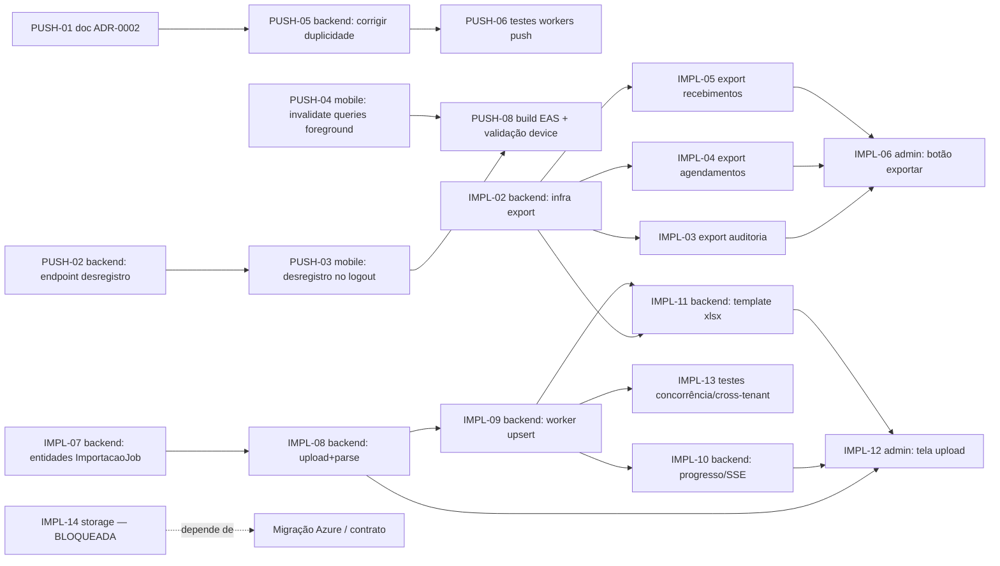

# Backlog técnico — Fechamento de push notifications + 4 ideias de melhoria do dono do produto

> Rascunho de trabalho, não é ADR. Objetivo: virar tasks executáveis sem reunião — mesmo padrão de `Docs/sad-aurora-backlog.md` (contexto, onde mexer, como implementar, critério de aceite, esforço, dependência) + indicação de qual agente/skill do projeto deve pegar cada task.
>
> Repos: **backend** = `C:\ESTUDO\TruckFlow` · **mobile** = `C:\tf-mobile` · **admin** = `C:\ESTUDO\TruckFlowApp`
>
> Duas investigações de código já foram feitas antes deste backlog (push notifications e as 4+1 ideias do dono do produto) — este documento só decompõe o que já foi levantado, não reinvestiga.

---

## 1. Resumo executivo

**Objetivo:** (1) fechar as lacunas reais do pipeline de push notifications — que já está implementado ponta a ponta, não é greenfield — e (2) decompor as 5 ideias de melhoria do dono do produto (landing, exportação, importação assíncrona, storage, cargos dinâmicos) na ordem de prioridade que o arquiteto sugeriu.

**O que já existe (não decompor, não refazer):**
- Pipeline completo Domain Event → Outbox → `OutboxProcessorWorker` → Handler → `Notificacao`/`NotificacaoEntrega` → `pg_notify` → SSE (admin) / Expo Push (mobile), com `PushDispatcherWorker` e `ReceiptPollerWorker` rodando (`src/TruckFlowApi/TruckFlow/Extensions/Notificacao/`).
- Mobile já registra token em `PushRegistrationService.ensureRegistered()` e trata tap de notificação em `usePushRegistration.ts`.
- Backend de notificações já expõe `POST /v1/dispositivos/registrar`, `GET /v1/notifications`, `POST /v1/notifications/send-empresa`, SSE em `GET /v1/notifications/stream`.
- Export de relatório já tem precedente parcial: `WEB-03` em `Docs/sad-aurora-backlog.md` troca o mock de `Relatorio.vue` por chamada real — este backlog generaliza a mesma ideia pra 3 telas com infra compartilhada; ao fechar `IMPL-02..06`, fechar/redirecionar `WEB-03` também (evitar 2 implementações divergentes de export).
- Decisão de provedor de nuvem (Azure, Brazil South) **já tomada** em 2026-09-18 (`Docs/sad-aurora-backlog.md` §1.4) — mas a execução (`Docs/migracao-azure-brasil.md`) ainda não rodou (depende de assinatura de contrato). Por isso o item de storage (D) continua bloqueado na prática, mesmo com a decisão de provedor resolvida.

**Total:** 23 tasks de dev (8 `PUSH-*`, 15 `IMPL-*`, sendo 1 bloqueada e 1 só-ADR) + 2 itens não-código.
**Esforço total estimado:** ~9d backend/mobile em `PUSH-*` + ~8,5d em exportação + ~10,5d em importação + 1d landing + 0,5d ADR cargos ≈ **~29,5 dias** de trabalho de dev, paralelizável entre 2 pessoas.
**Gate:** nenhuma destas tasks pertence à lista fixa do ADR-0004 (Pré-piloto/Pré-rollout) — são tratadas como `N/A (fora do ADR-0004)`; a única recomendação de sequenciamento forte é "fechar `PUSH-*` antes de escalar Aurora além da fábrica-piloto", sinalizada nos Riscos.

---

## 2. Itens não-código

| # | Item | Quem decide | Rascunho |
|---|---|---|---|
| 1 | Confirmar se as credenciais **FCM v1 (Android)** e **APNs (iOS)** já foram enviadas ao EAS (`eas credentials`) | Quem detém a conta Google Play Console / Apple Developer (comercial/fundador, não dev) | "Preciso confirmar com [dono da conta Apple/Google] se as credenciais de push já estão configuradas no EAS antes de gerar o build de preview do `PUSH-08`. Sem isso, o build sobe mas o device físico não recebe push real (só vai falhar silenciosamente na Expo)." |
| 2 | Decisão de quando assinar/executar a migração Azure (`Docs/migracao-azure-brasil.md`) | Comercial/jurídico (ligado à assinatura de contrato Aurora) | "Decisão de provedor já está tomada (Azure, Brazil South). Falta só a execução, amarrada à assinatura do contrato. `IMPL-14` (storage) fica bloqueada até aqui — não é um problema de engenharia." |

Nenhum dos dois vira task de dev no Jira.

---

## 3. Backlog por épico

### Épico PUSH — Fechar lacunas de push notifications (PRIORIDADE MÁXIMA)

#### `PUSH-01` — Atualizar ADR-0002 pra refletir o estado real + arquivar roadmap obsoleto
- **Prioridade:** P0 · **Repo:** backend · **Gate:** N/A (fora do ADR-0004) · **Tipo:** não-feature
- **Contexto:** `Docs/adr/0002-design-notificacoes.md` ainda lista em "Pendências pós-pipeline" coisas que já estão implementadas (`DispositivoUsuario`, integração Expo, workers, UI mobile básica). `Docs/adr/notificacoes-mobile-roadmap.md` descreve o mesmo pipeline como "Status: Pendente" quando está 100% implementado. Doc desatualizado confunde qualquer dev novo que abrir o ADR antes de tocar em notificações — e tanto `MOB-04` (sad-aurora-backlog) quanto `PUSH-04`/`PUSH-05` abaixo precisam que o ADR reflita a realidade antes de registrar as decisões novas.
- **Onde:** `Docs/adr/0002-design-notificacoes.md` (seção "Pendências pós-pipeline" e "Revisão 2026-05-21"), `Docs/adr/notificacoes-mobile-roadmap.md` (arquivo inteiro).
- **Como implementar:**
  1. Em `0002-design-notificacoes.md`, marcar como concluído: `DispositivoUsuario` + `POST /v1/dispositivos/registrar`, `PushDispatcherWorker`, `ReceiptPollerWorker`, UI mobile básica de notificações. Deixar como realmente pendente só o que falta de fato (ver `PUSH-02` a `PUSH-07` abaixo).
  2. Corrigir a divergência: o texto da seção "Retry por canal" diz "Push: 3 tentativas" mas `PushDispatcherWorker.cs:16` tem `MaxTentativas = 4` e backoff `30s/2min/10min/30min` (4 valores, não 3). Atualizar o ADR pro valor real do código (código vence, conforme `.claude/agents/dotnet-backend-specialist.md`).
  3. Em `notificacoes-mobile-roadmap.md`, adicionar um cabeçalho `**Status: Concluído (ver ADR-0002)**` com data, ou mover o arquivo pra uma pasta `Docs/adr/arquivados/` — escolher uma das duas, mas não deixar "Status: Pendente" mentindo sobre o que já está pronto.
- **Critério de aceite:** nenhuma seção do ADR-0002 descreve como "pendente" algo que já tem código em produção; número de tentativas no ADR bate com `PushDispatcherWorker.MaxTentativas`; `notificacoes-mobile-roadmap.md` não aparenta mais ser um roadmap aberto.
- **Dependências:** nenhuma.
- **Esforço:** 2h.
- **Agente:** `dotnet-backend-specialist` (é quem tem o CLAUDE.md/ADR como fonte de verdade pra manter vivo).

#### `PUSH-02` — Endpoint de desregistro de dispositivo (backend)
- **Prioridade:** P0 · **Repo:** backend · **Gate:** N/A · **Tipo:** não-feature (fecha ciclo de vida de credencial, risco de aparelho compartilhado)
- **Contexto:** Hoje só existe `POST /v1/dispositivos/registrar` (`DispositivosController.cs`). Não existe nenhum endpoint de desregistro — por isso `useAuthStore.ts` no mobile não tem o que chamar no logout. Aparelho compartilhado entre motoristas continua recebendo push do usuário anterior até o token expirar/falhar naturalmente.
- **Onde:**
  - `src/TruckFlowApi/TruckFlow.Domain/Dto/Notificacao/DesregistrarDispositivoDto.cs` (novo, mesma pasta de `RegistrarDispositivoDto.cs`)
  - `src/TruckFlowApi/TruckFlow.Application/Interfaces/IDispositivoUsuarioService.cs` (novo método)
  - `src/TruckFlowApi/TruckFlow.Application/Notificacoes/DispositivoUsuarioService.cs` (implementação)
  - `src/TruckFlowApi/TruckFlow/Controllers/DispositivosController.cs` (novo endpoint)
- **Como implementar:**
  1. `DesregistrarDispositivoDto { required string ExpoPushToken }`.
  2. `IDispositivoUsuarioService.DesregistrarAsync(DesregistrarDispositivoDto dto, CancellationToken ct)`.
  3. Em `DispositivoUsuarioService`: `_repo.GetByTokenAsync(dto.ExpoPushToken, ct)`; se não existir ou `existente.UsuarioId != _user.UserId`, lançar `NotFoundException` (não revelar se o token existe pra outro usuário); senão `existente.Desativar()` (método já existe em `DispositivoUsuario.cs:27`) + `_repo.UpdateAsync(existente, ct)`.
  4. Controller: `[HttpPost("desregistrar")]` no padrão verbo-ação já usado por `registrar` (mesmo estilo do controller, sem inventar rota REST nova).
- **Critério de aceite:** teste unitário (fake `IDispositivoUsuarioRepositorio`) — desregistro do próprio token marca `Ativo = false`; desregistro de token de outro usuário retorna 404 e **não** desativa o dispositivo do outro usuário. Teste cobrindo: token inexistente também retorna 404 (não 500).
- **Dependências:** nenhuma.
- **Esforço:** 0.5d.
- **Agente:** `dotnet-backend-specialist`.

#### `PUSH-03` — Mobile: desregistrar push token no logout
- **Prioridade:** P0 · **Repo:** mobile · **Gate:** N/A · **Tipo:** não-feature
- **Contexto:** `useAuthStore.ts:67-80` (`signOut`) só chama `POST /Auth/logout-mobile`; nunca desregistra o `expoPushToken` do dispositivo. Depende do `PUSH-02` existir no backend.
- **Onde:** `C:\tf-mobile\src\stores\useAuthStore.ts` (`signOut`), `C:\tf-mobile\src\services\NotificacaoService.ts` (novo método `desregistrarDispositivo`), `C:\tf-mobile\src\services\PushRegistrationService.ts` (expor o token atual, ou reler via `Notifications.getExpoPushTokenAsync()` outra vez — mais simples: armazenar o último token registrado, ex. `expo-secure-store` ou variável no próprio `PushRegistrationService`).
- **Como implementar:**
  1. `PushRegistrationService` passa a guardar o último `expoPushToken` registrado com sucesso (atributo estático/memória — não precisa persistir, basta durar a sessão).
  2. `NotificacaoService.desregistrarDispositivo(expoPushToken: string)` → `POST /dispositivos/desregistrar`.
  3. Em `useAuthStore.signOut`, antes (ou em paralelo, com `try/catch` que não bloqueia o logout) de chamar `/Auth/logout-mobile`: se houver token conhecido, chamar `NotificacaoService.desregistrarDispositivo(token)`. Igual ao padrão já usado ali — chamada de rede dentro de `try { } catch { }` que não impede o logout local de completar.
- **Critério de aceite:** teste manual/e2e — logar com usuário A no device, deslogar, logar com usuário B no mesmo device: push disparado para A depois do logout não chega mais nesse device (verificável checando `DispositivoUsuario.Ativo = false` para o token de A no banco após o logout).
- **Dependências:** `PUSH-02`.
- **Esforço:** 0.5d.
- **Agente:** `mobile-expo-specialist`.

#### `PUSH-04` — Mobile: invalidar queries do TanStack ao receber push em foreground
- **Prioridade:** P1 · **Repo:** mobile · **Gate:** N/A · **Tipo:** não-feature (bug de UX)
- **Contexto:** `usePushRegistration.ts` só registra `addNotificationResponseReceivedListener` (tap na notificação). Não existe `addNotificationReceivedListener` (chegada em foreground) — por isso o banner aparece mas a lista de notificações/badge no app não atualiza até o usuário puxar manualmente (pull-to-refresh) ou navegar.
- **Onde:** `C:\tf-mobile\src\hooks\usePushRegistration.ts`, usa as mesmas query keys de `C:\tf-mobile\src\hooks\useNotificacao.ts` (`notificacaoQueryKey`, `notificacaoUnreadCountQueryKey`, `notificacaoAgendamentoQueryKey` em `src/queries/notificacao.queries.ts`).
- **Como implementar:**
  1. Em `usePushRegistration.ts`, adicionar um segundo `useEffect` registrando `Notifications.addNotificationReceivedListener((notification) => { ... })`, no mesmo padrão de guard (`if (!Notifications) return;`, `try/catch` por causa do Expo Go) e cleanup (`sub.remove()`) do listener de `Response` já existente.
  2. Dentro do callback, chamar `queryClient.invalidateQueries({ queryKey: [notificacaoQueryKey] })` + `[notificacaoUnreadCountQueryKey]` (precisa de `useQueryClient()` no hook, hoje ele não usa).
  3. Se `data.agendamentoId` estiver no payload, invalidar também a query do agendamento específico (mesma chave usada em `useAgendamento.ts`), pra o ticket do agendamento atualizar status sem o motorista precisar saltar de tela.
- **Critério de aceite:** com o app em foreground, simular push de teste (Expo push tool ou endpoint de teste) e verificar que o badge/lista de notificações atualiza sem interação do usuário, no mesmo ciclo do React Query (teste manual com device físico — Expo Go não dispara notificação nativa).
- **Dependências:** nenhuma (independente de `PUSH-02`/`PUSH-03`).
- **Esforço:** 1d.
- **Agente:** `mobile-expo-specialist`.

#### `PUSH-05` — Backend: reduzir janela de push duplicado no `PushDispatcherWorker`
- **Prioridade:** P1 · **Repo:** backend · **Gate:** N/A (mas recomendado antes de escalar Aurora — ver Riscos) · **Tipo:** não-feature (confiabilidade)
- **Contexto:** Em `PushDispatcherWorker.ProcessNextAsync` (`src/TruckFlowApi/TruckFlow/Extensions/Notificacao/PushDispatcherWorker.cs:86-157`), a transação Postgres é aberta em `tx = BeginTransactionAsync()` (linha 86), a entrega é claimed via `FOR UPDATE SKIP LOCKED` ainda dentro dela, e só é commitada depois de `await expo.SendAsync(...)` (linha 125) ser chamado e o resultado ser persistido (linhas 156-157). Se o processo crashar **depois** da Expo aceitar o envio mas **antes** do commit, a transação não efetiva, o lock é liberado, a entrega volta a aparecer como `Pendente`, e o próximo ciclo do worker (ou de outra instância) reenvia o mesmo push — motorista recebe duplicado.
- **Onde:** `src/TruckFlowApi/TruckFlow/Extensions/Notificacao/PushDispatcherWorker.cs`, `src/TruckFlowApi/TruckFlow.Domain/Enums/StatusEntregaNotificacao.cs`, `src/TruckFlowApi/TruckFlowApi.Infra/Repositories/NotificacaoEntregaRepositorio.cs`.
- **Como implementar (recomendado — encolher a transação em volta da chamada de rede):**
  1. Adicionar `Processando = 4` a `StatusEntregaNotificacao` (é só um valor de enum armazenado como `int`, não precisa de migration de schema).
  2. Novo método na entidade `NotificacaoEntrega`: `MarcarProcessando()` (seta `Status = Processando`, `UltimaTentativaEm = now`, `TentativasEfetuadas++`).
  3. **Transação 1** (curta): claim via `FOR UPDATE SKIP LOCKED` (query hoje em `NotificacaoEntregaRepositorio.cs:17-30` já pega `Status = 0`; ajustar pra também pegar `Status = 4` com `UltimaTentativaEm` mais antigo que um timeout de "órfão", ex. 2 minutos — cobre o caso do worker ter crashado depois da Transação 1 e antes da Transação 2) → `MarcarProcessando()` → `SaveChangesAsync` → `CommitAsync`. Libera o lock imediatamente, **antes** de chamar a Expo.
  4. Chamar `expo.SendAsync(...)` **fora** de qualquer transação aberta.
  5. **Transação 2**: reabrir o `AppDbContext`/transação, reler a entrega pelo `Id` (concurrency token `xmin` garante que, se outro worker já tiver reclaimado por timeout, o `SaveChanges` falha com conflito em vez de sobrescrever silenciosamente), aplicar `MarcarEnviado`/`RegistrarFalha`, `SaveChangesAsync`, `CommitAsync`.
  6. Documentar em `PUSH-01`/ADR-0002 que isso **reduz drasticamente mas não elimina** o risco de duplicata (ainda existe uma janela entre "Expo aceitou" e "Transação 2 comitou"), e que a Expo Push API não oferece idempotency key — é o trade-off aceito (consistente com a filosofia de at-least-once já documentada na revisão do Outbox).
- **Critério de aceite:** teste de integração que força uma exceção *depois* do `expo.SendAsync` simulado e *antes* da Transação 2 (via fake `IExpoPushClient` que lança depois de retornar — ou split manual do fluxo no teste) — a entrega fica em `Processando`, não é reclaimed por outro worker dentro do timeout, e é reclaimed (reenviada) só depois do timeout expirar. Teste de 2 workers concorrentes (igual padrão do `PUSH-06`) continua garantindo exclusividade no claim.
- **Dependências:** `PUSH-01` (ADR atualizado primeiro, decisão nova documentada depois).
- **Esforço:** 1d.
- **Agente:** `dotnet-backend-specialist`.

#### `PUSH-06` — Testes de integração: `PushDispatcherWorker` e `ReceiptPollerWorker` com Expo fake
- **Prioridade:** P1 · **Repo:** backend · **Gate:** N/A · **Tipo:** não-feature (teste)
- **Contexto:** Hoje só existem `NotificacaoCrossTenantTests` e `OutboxDispatcherConcorrenciaTests` — nenhum cobre o worker que efetivamente fala com a Expo. Regra do projeto: "toda task que mude comportamento sai com teste" — e isso vale em dobro pra confiabilidade de push (motorista não reporta "não recebi push", só reporta "não vim buscar a carga").
- **Onde:** novo `src/TruckFlowApi/TruckFlow.Test/Integration/PushDispatcherConcorrenciaTests.cs` e `.../ReceiptPollerTests.cs`; novo fake `src/TruckFlowApi/TruckFlow.Test/Integration/Fakes/FakeExpoPushClient.cs` implementando `IExpoPushClient`; estender `DispatcherTestHelper.cs` (ou criar `PushDispatcherTestHelper.cs` ao lado) com um `BuildServiceProvider`/`CreateWorker` que registra o fake no lugar do `ExpoPushClient` real.
- **Como implementar:**
  1. `FakeExpoPushClient : IExpoPushClient` configurável por teste (lista de respostas pré-definidas por token, ou callback) — sem HTTP real, mesma filosofia de "sem mock em teste de integração" aplicada só à borda externa (Expo), não ao Postgres.
  2. Replicar o padrão exato de `OutboxDispatcherConcorrenciaTests.cs`: seed de `Empresa` + `Usuario` motorista + `DispositivoUsuario` ativo + `Notificacao`/`NotificacaoEntrega(Canal=Push, Status=Pendente)`; 2 instâncias de `PushDispatcherWorker` (via `IServiceScopeFactory` próprio cada) rodando `StartAsync` concorrente; assert no final que existe **exatamente uma** chamada ao `FakeExpoPushClient.SendAsync` pra aquela entrega (contador thread-safe no fake) e que `NotificacaoEntrega.Status` final é `Enviado` com `TentativasEfetuadas == 1`.
  3. Caso 2 (regressão do `PUSH-05`): entrega presa em `Processando` com `UltimaTentativaEm` antigo é reclaimed e processada; entrega em `Processando` recente **não** é reclaimed por um segundo worker.
  4. `ReceiptPollerTests.cs`: entrega `Enviado` com `ProviderMessageId` de ticket → `FakeExpoPushClient.GetReceiptsAsync` retorna `DeviceNotRegistered` → assert que `DispositivoUsuario.Ativo` vira `false` e `ReceiptCheckedAt` é preenchido (replicando a lógica de `ReceiptPollerWorker.cs:116-127`).
- **Critério de aceite:** `dotnet test --filter PushDispatcher` e `--filter ReceiptPoller` verdes; suite roda no `CI-01` (sad-aurora-backlog) quando ele existir.
- **Dependências:** `PUSH-05` (testa o comportamento corrigido, inclusive os cenários novos de `Processando`).
- **Esforço:** 1.5d.
- **Agente:** `qa-expert` em par com `dotnet-backend-specialist` (fixture de worker é specialist; casos de teste e cobertura de cenário é QA).

#### `PUSH-07` — Handler de referência para novo evento de push + checklist
- **Prioridade:** P3 (fazer só quando o dono do produto pedir um evento novo específico) · **Repo:** backend · **Gate:** N/A · **Tipo:** feature (catálogo/preparação, não está sendo pedido agora)
- **Contexto:** Hoje só `AgendamentoCanceladoEvent`, `AgendamentoEvent.MotoristaChegouEvent` e `AgendamentoEvent.AgendamentoReagendadoEvent` têm handler (`NotificacaoDependencyInjection.cs:39-49`). O ADR-0002 lista mais 5 candidatos (`AgendamentoConfirmadoEvent`, `AgendamentoExpiradoEvent`, `MotoristaAtrasoInformadoEvent`, `MotoristaSaiuEvent`, `JanelaProximaEvent`) sem handler ainda. Não implementar os 5 agora — só deixar **um exemplo de referência completo** pra quando a prioridade vier, em vez de reconstruir o padrão do zero cada vez.
- **Onde:** `src/TruckFlowApi/TruckFlow.Application/Notificacoes/Handlers/AgendamentoConfirmadoNotificacaoHandler.cs` (novo, espelhando `AgendamentoCanceladoNotificacaoHandler.cs`), registro em `NotificacaoDependencyInjection.cs`.
- **Como implementar:**
  1. Confirmar que `AgendamentoConfirmadoEvent` já existe em `Domain/Events/` (senão criar, seguindo `AgendamentoCanceladoEvent`).
  2. Implementar o handler decidindo destinatário (motorista do agendamento), `Titulo`/`Corpo`, `Prioridade`, criando `Notificacao` + `NotificacaoEntrega(InApp, Enviado)` + `NotificacaoEntrega(Push, Pendente)` — copiar exatamente a estrutura de `AgendamentoCanceladoNotificacaoHandler.cs`.
  3. Registrar em `NotificacaoDependencyInjection.cs` junto dos outros `AddScoped<IDomainEventHandler<...>>`.
  4. Deixar 1 parágrafo no ADR-0002 (seção "Eventos de domínio adicionais") apontando esse handler como o exemplo a copiar pros próximos 4.
- **Critério de aceite:** teste unitário do handler (fake de repositório) cobrindo o cenário "motorista recebe notificação ao ter agendamento confirmado"; teste de integração reaproveitando o padrão do `OutboxDispatcherConcorrenciaTests` confirmando que o evento chega ponta a ponta até `Notificacao` criada.
- **Dependências:** nenhuma.
- **Esforço:** 1d.
- **Agente:** `dotnet-backend-specialist`.

#### `PUSH-08` — Build EAS real (device físico) e validação ponta a ponta do registro de push
- **Prioridade:** P1 · **Repo:** mobile · **Gate:** N/A · **Tipo:** não-feature (validação operacional)
- **Contexto:** Expo Go pula o registro de token nativo (`PushRegistrationService.ensureRegistered()` já faz early-return se `!Device?.isDevice` ou módulo nativo ausente). Todo o trabalho de `PUSH-03`/`PUSH-04` só é validável de verdade com um build EAS instalado num device físico Android/iOS.
- **Onde:** `C:\tf-mobile` (perfil `preview` do `eas.json`, já existente).
- **Como implementar:**
  1. `eas build --profile preview --platform android` (e `ios` se houver device de teste disponível).
  2. Instalar no device físico, logar como motorista de teste, confirmar no banco (`SELECT * FROM "DispositivoUsuario" WHERE "UsuarioId" = ...`) que o token foi registrado com `Ativo = true`.
  3. Disparar um cancelamento de agendamento de teste pelo admin → confirmar que o push chega no device com tela bloqueada.
  4. Deslogar (depois de `PUSH-03` mergeado) → confirmar `Ativo = false` no banco pro token daquele device.
  5. Repetir o teste de foreground (`PUSH-04`) — push chegando com app aberto atualiza badge sem interação.
- **Critério de aceite:** checklist dos 4 passos acima documentado (print ou nota no PR) com resultado observado; se falhar em qualquer passo, abrir bug específico em vez de marcar como pronto.
- **Dependências:** `PUSH-03`, `PUSH-04` (valida o comportamento que essas tasks introduzem).
- **Esforço:** 0.5d (+ tempo de fila de build EAS, fora do controle do dev).
- **Agente:** `mobile-expo-specialist`.

---

### Épico IMPL-A — Landing page

#### `IMPL-01` — Redesenhar tipografia e visual da landing
- **Prioridade:** P2 · **Repo:** admin (TruckFlowApp) · **Gate:** N/A · **Tipo:** feature
- **Contexto:** Pedido direto do dono do produto: a landing "está com muita cara de IA", precisa melhorar tipografia e visual. Zero risco técnico — é página pública, sem dado de tenant, sem lógica de negócio.
- **Onde:** `C:\ESTUDO\TruckFlowApp\src\views\HomePage.vue` (rota `/`), `SaibaMais.vue` (rota `/more`), `ContatoView.vue` (rota `/contact`) — ver `src/router/index.ts:42-56`.
- **Como implementar:**
  1. Revisar a escala tipográfica (hoje usa tamanhos fixos em `px` inline no `<style>`/`style=` do template, ex. `font-size: 22px` no app-bar) — trocar por uma escala consistente (ex. Vuetify `text-h1`..`text-body-2` ou tokens próprios) em vez de valores soltos por elemento.
  2. Revisar hierarquia visual (contraste, espaçamento, pesos de fonte) nas 3 páginas, mantendo a paleta de marca já em uso (`rgba(9, 24, 44, ...)`).
  3. Não introduzir nenhuma dependência nova de UI sem necessidade — Vuetify já cobre tipografia/grid.
- **Critério de aceite:** validação visual com o dono do produto (é página de marketing, critério de aceite aqui é aprovação humana, não automatizável) + `pnpm run build` sem erro de `vue-tsc`.
- **Dependências:** nenhuma.
- **Esforço:** 1d.
- **Agente:** `vue-specialist` (ou `frontend-developer` se o trabalho for majoritariamente CSS/design sem lógica Vue).

---

### Épico IMPL-B — Exportação de relatórios (streaming CSV/XLSX)

#### `IMPL-02` — Infra compartilhada de exportação streaming (backend)
- **Prioridade:** P2 · **Repo:** backend · **Gate:** N/A · **Tipo:** feature
- **Contexto:** Pré-requisito de `IMPL-03/04/05`. Projeto não tem lib de Excel hoje. Decisão: **ClosedXML** para `.xlsx` (streaming real de linha-a-linha não é o forte dele, mas é maduro e já é referência no mercado .NET; volume de Aurora — centenas/poucos milhares de linhas por export — não justifica a complexidade adicional do MiniExcel só por streaming puro) + CSV nativo via `IAsyncEnumerable`/`Response.Body` sem lib nenhuma (é só texto delimitado).
- **Onde:** novo `src/TruckFlowApi/TruckFlow.Application/Exports/` (`IReportExportService`, `CsvStreamWriter`, `XlsxExportBuilder`), `src/TruckFlowApi/TruckFlow/TruckFlow.csproj` (adicionar `ClosedXML`).
- **Como implementar:**
  1. `dotnet add package ClosedXML` no projeto `TruckFlow` (ou `TruckFlow.Application`, onde os services vivem).
  2. `CsvStreamWriter`: helper genérico que recebe `IAsyncEnumerable<T>` + mapeamento de colunas (`Func<T, object?[]>` ou similar) e escreve direto em `HttpResponse.Body`, sem materializar tudo em memória — usa `Content-Type: text/csv` + `Content-Disposition: attachment`.
  3. `XlsxExportBuilder`: helper que recebe `IReadOnlyList<T>` (xlsx geralmente não compensa streaming puro pro volume de Aurora) + mapeamento de colunas, monta um `XLWorkbook` do ClosedXML e retorna `byte[]`/`MemoryStream` como `FileStreamResult` com `Content-Type: application/vnd.openxmlformats-officedocument.spreadsheetml.sheet`.
  4. Os endpoints de `IMPL-03/04/05` **reaproveitam os `XxxListQueryDto` já existentes** (`AuditLogListQueryDto`, `AgendamentoFilterDto`, etc.) — a única mudança é não paginar (remover `Take`/`Skip` do `IQueryable` antes de streamar) e aplicar o filtro de tenant automático normal (`IEmpresaScoped` já cobre isso, nenhuma query manual de `EmpresaId`).
- **Critério de aceite:** teste unitário do `CsvStreamWriter` com uma lista fake de >1 "página" de dados — output CSV tem todas as linhas, não só a primeira página; teste de que o helper não trava com lista vazia (gera CSV só com header).
- **Dependências:** nenhuma.
- **Esforço:** 1d.
- **Agente:** `dotnet-backend-specialist`.

#### `IMPL-03` — Exportação de Auditoria
- **Prioridade:** P2 · **Repo:** backend · **Gate:** N/A · **Tipo:** feature
- **Contexto:** Dono do produto quer exportação onde há volume real — auditoria é uma das 3 telas escolhidas.
- **Onde:** `src/TruckFlowApi/TruckFlow/Controllers/AuditLogController.cs` (hoje só `GET /v1/audit` com `AuditLogListQueryDto`), `src/TruckFlowApi/TruckFlow.Application/Interfaces/IAuditLogService.cs` (novo método).
- **Como implementar:**
  1. Novo endpoint `GET /v1/audit/export?formato=csv|xlsx` com os mesmos filtros de `AuditLogListQueryDto` (reaproveitar o DTO, não duplicar query params), mantendo `[Authorize(Roles = RoleGroups.CanViewAuditLogs)]`.
  2. Service: mesma query de `GetPaged`, mas sem paginação, streamada via `IAsyncEnumerable` pro `CsvStreamWriter` (`IMPL-02`) quando `formato=csv`, ou materializada + `XlsxExportBuilder` quando `formato=xlsx`.
  3. Limite de segurança: se o filtro não restringir período, aplicar um teto (ex. últimos 12 meses por padrão) pra evitar export acidental de toda a tabela — documentar no Swagger.
- **Critério de aceite:** teste de integração — usuário da Empresa A exportando não recebe nenhuma linha de auditoria da Empresa B (mesma garantia do filtro global de tenant, mas vale o teste explícito já que aqui a query ignora paginação); CSV gerado abre corretamente e tem o mesmo número de linhas que `GET /v1/audit` sem paginação retornaria.
- **Dependências:** `IMPL-02`.
- **Esforço:** 0.5d.
- **Agente:** `dotnet-backend-specialist`.

#### `IMPL-04` — Exportação de Agendamentos
- **Prioridade:** P2 · **Repo:** backend · **Gate:** N/A · **Tipo:** feature
- **Onde:** `src/TruckFlowApi/TruckFlow/Controllers/AgendamentoAdminController.cs` (rota base `v1/AgendamentoAdmin`, filtro hoje é `AgendamentoFilterDto` no `GetByFilters`), `IAgendamentoAdminService`.
- **Como implementar:** mesmo padrão de `IMPL-03`: `GET /v1/AgendamentoAdmin/export?formato=csv|xlsx` reaproveitando `AgendamentoFilterDto`, `[Authorize(Roles = RoleGroups.CanManageGrade)]` (mesmo do controller).
- **Critério de aceite:** export cross-tenant bloqueado (teste igual ao de `IMPL-03`); colunas do export cobrem pelo menos os campos já exibidos em `ProgramacaoView.vue` hoje (não inventar campo novo que o admin nunca viu).
- **Dependências:** `IMPL-02`.
- **Esforço:** 0.5d.
- **Agente:** `dotnet-backend-specialist`.

#### `IMPL-05` — Exportação de Recebimentos
- **Prioridade:** P2 · **Repo:** backend · **Gate:** N/A · **Tipo:** feature
- **Onde:** `src/TruckFlowApi/TruckFlow/Controllers/RecebimentoController.cs` (classe `RecebimentosController`, rota `v1/recebimentos`), `IRecebimentoEventoService`.
- **Como implementar:** mesmo padrão, `GET /v1/recebimentos/export?formato=csv|xlsx`. Decidir no início da task se o escopo é "eventos de recebimento" (o que o controller já expõe) ou "planejamento de recebimento" (`PlanejamentoRecebimentoController`) — confirmar com o dono do produto qual delas tem o "volume real" citado no pedido antes de implementar; não assumir.
- **Critério de aceite:** igual padrão dos anteriores (cross-tenant + paridade de colunas com a tela equivalente do admin).
- **Dependências:** `IMPL-02`.
- **Esforço:** 0.5d.
- **Agente:** `dotnet-backend-specialist`.

#### `IMPL-06` — Admin: botão/componente de exportação reutilizável
- **Prioridade:** P2 · **Repo:** admin · **Gate:** N/A · **Tipo:** feature
- **Contexto:** 3 telas, mesmo padrão de botão — construir componente uma vez, não copiar/colar 3x. Também é o momento de fechar `WEB-03` (`Docs/sad-aurora-backlog.md`), que hoje é um mock em `Relatorio.vue:265-278` — redirecionar esse botão pro mesmo componente em vez de manter 2 implementações de export divergentes.
- **Onde:** novo `src/components/shared/ExportarButton.vue` (ou nome equivalente ao padrão de pastas do projeto), aplicado em `AuditoriaView.vue`, `ProgramacaoView.vue`, `RecebimentoView.vue`, e revisão de `Relatorio.vue`.
- **Como implementar:**
  1. Componente recebe a URL base do export + os filtros atuais da tela (mesmos filtros já usados na query paginada) + formato escolhido (menu simples CSV/XLSX).
  2. Chama o endpoint via `axios` com `responseType: 'blob'`, gera o download via `URL.createObjectURL` (padrão já citado em `WEB-03`).
  3. Aplicar nas 3 telas, passando os filtros atuais de cada uma.
  4. Em `Relatorio.vue`, decidir: ou o botão existente passa a chamar um dos 3 exports novos (se fizer sentido pro relatório que a tela já representa), ou a tela é descontinuada em favor dos botões nas telas de origem — registrar a decisão tomada no PR.
- **Critério de aceite:** clicar em "Exportar" em qualquer uma das 3 telas baixa um arquivo real com os dados filtrados visíveis na tela; `Relatorio.vue` não tem mais `setTimeout`/mock.
- **Dependências:** `IMPL-03`, `IMPL-04`, `IMPL-05`.
- **Esforço:** 1.5d.
- **Agente:** `vue-specialist`.

---

### Épico IMPL-C — Importação assíncrona robusta

> Decisão de arquitetura que resolve um conflito implícito: o enunciado original não diz onde o arquivo enviado fica guardado entre o upload e o processamento pelo worker — e `IMPL-14` (storage) está bloqueada. Solução: **o endpoint de upload faz o parse da planilha de forma síncrona na própria requisição** (operação rápida — é leitura de linhas, não é o trabalho pesado) e grava o conteúdo já estruturado em `ImportacaoJobLinha` (jsonb por linha). O `ImportacaoWorker` nunca lê um arquivo do disco/blob — só lê linhas já no Postgres. Isso elimina a dependência de `IMPL-14` para este épico inteiro.

#### `IMPL-07` — Entidades `ImportacaoJob` / `ImportacaoJobLinha` + migration
- **Prioridade:** P2 · **Repo:** backend · **Gate:** N/A · **Tipo:** feature
- **Onde:** `src/TruckFlowApi/TruckFlow.Domain/Entities/ImportacaoJob.cs`, `ImportacaoJobLinha.cs` (novos), `src/TruckFlowApi/TruckFlowApi.Infra/Database/EntitiesMapping/` (configuração EF), migration nova em `src/TruckFlowApi/TruckFlowApi.Infra/Migrations/`.
- **Como implementar:**
  1. `ImportacaoJob : EntidadeBase, IEmpresaScoped` — `TipoEntidade` (enum: `Produto`, `Fornecedor`, `LocalDescarga`, `UnidadeEntrega`), `Status` (enum: `Pendente`, `Processando`, `Concluido`, `ConcluidoComErros`, `Falhou`), `TotalLinhas`, `LinhasProcessadas`, `LinhasComErro`, `ArquivoNomeOriginal` (varchar — só o nome, não o binário), `ConcluidoEm` (nullable), `xmin` como concurrency token (mesmo padrão de `Agendamento`/`Notificacao`).
  2. `ImportacaoJobLinha : EntidadeBase, IEmpresaScoped` — `ImportacaoJobId` (FK), `NumeroLinha`, `DadosOriginais` (jsonb — a linha crua), `Status` (enum: `Pendente`, `Processado`, `Erro`), `MensagemErro` (text, nullable), `ChaveNatural` (varchar — CNPJ do fornecedor, código do produto, etc., usada no upsert idempotente).
  3. Índice `(Status, ImportacaoJobId)` parcial em `ImportacaoJobLinha` onde `Status = 'Pendente'` pra acelerar o claim do worker em lote.
  4. Migration única cobrindo as duas tabelas.
- **Critério de aceite:** `dotnet ef database update` aplica sem erro; teste de integração simples confirma que `ImportacaoJob` de uma empresa não aparece em query de outra (filtro global de tenant funcionando, igual qualquer outra entidade `IEmpresaScoped`).
- **Dependências:** nenhuma.
- **Esforço:** 1d.
- **Agente:** `dotnet-backend-specialist` (entidade + EF) com `postgres-pro` revisando os índices se o volume esperado por fábrica for grande.

#### `IMPL-08` — Endpoint de upload com parse síncrono
- **Prioridade:** P2 · **Repo:** backend · **Gate:** N/A · **Tipo:** feature
- **Contexto:** Usuário sobe a planilha; o endpoint não processa negócio, só estrutura. `EmpresaId` do job vem sempre da claim do usuário autenticado (`CurrentUserGuard`), **nunca** de nenhuma coluna da planilha — mesma regra de qualquer outra entidade `IEmpresaScoped`. Atenção redobrada aqui porque é upload de dados em massa vindo de fora.
- **Onde:** novo `src/TruckFlowApi/TruckFlow/Controllers/ImportacoesController.cs`, `IImportacaoService` novo, usando o `XlsxExportBuilder`/lib do `IMPL-02` só pra **ler** (ClosedXML lê e escreve `.xlsx`).
- **Como implementar:**
  1. `POST /v1/importacoes/{tipoEntidade}` `[Consumes("multipart/form-data")]`, `IFormFile arquivo` — mesmo padrão de `NotaFiscalController.ParseNotaFiscalXml` (`xmlFile == null || xmlFile.Length == 0` → `BadRequest`).
  2. Ler o `.xlsx` linha a linha com ClosedXML (`workbook.Worksheet(1).RowsUsed()`), sem validação de negócio ainda — só estrutura: cada linha vira um `ImportacaoJobLinha.DadosOriginais` (jsonb serializado das colunas cruas).
  3. Criar `ImportacaoJob(Status = Pendente, EmpresaId = _user.EmpresaId, TotalLinhas = N)` + as `N` linhas, tudo numa transação.
  4. Retornar `{ jobId }` — front já pode começar a acompanhar.
  5. Limite de tamanho de arquivo/linhas (ex. 10.000 linhas) pra não travar a requisição síncrona — acima disso, `BadRequestException` orientando a dividir o arquivo.
- **Critério de aceite:** upload de planilha válida de Fornecedor cria `ImportacaoJob` com `TotalLinhas` igual ao número de linhas de dados (exclui header); upload com `EmpresaId` "escondido" em alguma coluna da planilha é **ignorado** — o job usa só a claim do usuário (teste explícito disso).
- **Dependências:** `IMPL-07`.
- **Esforço:** 1.5d.
- **Agente:** `dotnet-backend-specialist`.

#### `IMPL-09` — `ImportacaoWorker` (validação + upsert idempotente)
- **Prioridade:** P2 · **Repo:** backend · **Gate:** N/A · **Tipo:** feature
- **Contexto:** Trabalho pesado do pipeline. Avaliado e descartado `BullMQ` pra isso: existe port .NET oficial (pacote NuGet `BullMQ`, de `taskforcesh/bullmq`) que roda inclusive sobre Postgres 13+ (não só Redis) — mas está na v1.2.2, publicada há poucos dias, ~1,4 mil downloads totais, sem histórico de produção. Trazer uma dependência tão nova pra uma peça crítica multi-tenant (job de importação lida com `EmpresaId` de fábricas diferentes) é risco desnecessário havendo alternativa comprovada. Também não usar o Outbox existente (ele é pra efeitos colaterais curtos — um job longo de importação travaria a fila de notificações). Usar o padrão que o projeto já tem rodando em produção: `BackgroundService` + `FOR UPDATE SKIP LOCKED` (mesmo de `NotificacaoEntregaRepositorio.cs:17-30`) + `WithTenant` (mesmo de todo worker cross-tenant do projeto). Reavaliar BullMQ .NET daqui uns meses se ele amadurecer (mesmo time do BullMQ Node, que é maduro e bem adotado).
- **Onde:** novo `src/TruckFlowApi/TruckFlow/Extensions/Importacao/ImportacaoWorker.cs`, registro em novo `ImportacaoDependencyInjection.cs` (mesmo padrão de `NotificacaoDependencyInjection.cs`), validators FluentValidation novos por tipo de entidade em `TruckFlow.Application/Validators/Importacao/`.
- **Como implementar:**
  1. Query de claim: `SELECT * FROM "ImportacaoJob" WHERE "Status" IN (0, 1) ... FOR UPDATE SKIP LOCKED LIMIT 1` (Pendente ou Processando-travado-há-muito-tempo, mesma lógica de recuperação de órfão do `PUSH-05`).
  2. Dentro de `_empresaContext.WithTenant(job.EmpresaId)`: processar `ImportacaoJobLinha(Status = Pendente)` em lotes de 100 — por linha: `JsonSerializer.Deserialize` do `DadosOriginais`, validar com o `FluentValidation` do tipo de entidade (reaproveitar validators já existentes se a entidade já tiver um create/update DTO equivalente — ex. `ProdutoCreateDto` já deve ter validator), e fazer upsert pela `ChaveNatural` (CNPJ, código do produto): `UPDATE` se já existe na tabela de destino (`Produto`, `Fornecedor`, etc.) com aquela chave dentro da empresa, `INSERT` se não.
  3. Checkpoint: depois de cada lote, `UPDATE ImportacaoJob SET LinhasProcessadas = ..., LinhasComErro = ...` e commit — se o worker cair no meio, só as linhas já marcadas `Processado`/`Erro` não são reprocessadas (idempotência garante que reprocessar uma linha já upada não duplica).
  4. Ao final: `Status = Concluido` (zero erro) ou `ConcluidoComErros` (algum erro, mas processou o resto) ou `Falhou` (erro fatal, ex. tipo de entidade desconhecido).
  5. Registrar em `ImportacaoDependencyInjection.AddImportacao()`, chamado a partir do `Program.cs` igual às outras extensions.
- **Critério de aceite:** linha com CNPJ já existente faz `UPDATE` em vez de duplicar fornecedor; linha inválida (ex. CNPJ malformado) marca `Erro` com `MensagemErro` legível e **não** aborta o resto do lote; reiniciar o worker no meio de um job grande retoma do ponto certo (linhas já `Processado` não reaparecem).
- **Dependências:** `IMPL-08`.
- **Esforço:** 2d.
- **Agente:** `dotnet-backend-specialist`.

#### `IMPL-10` — Progresso: endpoint de polling + evento SSE
- **Prioridade:** P2 · **Repo:** backend · **Gate:** N/A · **Tipo:** feature
- **Contexto:** Reaproveitar o SSE existente (Postgres `LISTEN/NOTIFY`, mesma infra de `RealtimeNotificationListener.cs`) em vez de inventar WebSocket novo.
- **Onde:** `src/TruckFlowApi/TruckFlow/Controllers/ImportacoesController.cs` (endpoint de polling), canal novo `importacao:{empresaId}` ao lado do canal `notif:empresa:{empresaId}` já usado (`RealtimeNotificationInterceptor.ChannelName`, `RealtimeNotificationListener.cs`).
- **Como implementar:**
  1. `GET /v1/importacoes/{id}` — retorna `Status`, `TotalLinhas`, `LinhasProcessadas`, `LinhasComErro` (alternativa simples de polling, sempre disponível mesmo se o SSE cair).
  2. No `ImportacaoWorker` (`IMPL-09`), depois de cada checkpoint de lote, `pg_notify('importacao_progresso', job.Id::text)` — reaproveitar o mesmo `INotificationConnectionManager`/`SseNotificationStreamer` já existente, só filtrando por um novo tipo de evento em vez de criar um segundo pipeline SSE do zero.
  3. Decisão de escopo: se o esforço de plugar no SSE existente ficar maior que o ganho (é só uma barra de progresso, não é tempo real crítico como notificação), a alternativa mais simples é **só** o polling do passo 1, com o front reconsultando a cada 2-3s enquanto `Status` não for terminal — documentar qual das duas foi escolhida no PR.
- **Critério de aceite:** `GET /v1/importacoes/{id}` reflete o progresso real enquanto o worker processa (teste de integração chamando o endpoint entre lotes); se optar por SSE, evento chega no front sem polling.
- **Dependências:** `IMPL-09`.
- **Esforço:** 1d.
- **Agente:** `dotnet-backend-specialist`.

#### `IMPL-11` — Endpoint de template `.xlsx` por tipo de entidade
- **Prioridade:** P2 · **Repo:** backend · **Gate:** N/A · **Tipo:** feature
- **Onde:** `ImportacoesController.cs` (endpoint novo), reaproveitando `XlsxExportBuilder` (`IMPL-02`) só pra gerar um arquivo vazio com header.
- **Como implementar:** `GET /v1/importacoes/{tipoEntidade}/template` — monta um `XLWorkbook` só com a linha de header esperada (nomes de coluna) pro tipo de entidade, gerado em código (não precisa de storage, é gerado on-the-fly a cada request).
- **Critério de aceite:** template baixado tem exatamente as colunas que o `IMPL-09` espera ler pra aquele tipo de entidade (nenhuma coluna extra ou faltante).
- **Dependências:** `IMPL-02`, `IMPL-09` (precisa saber o schema de colunas esperado por cada entidade).
- **Esforço:** 0.5d.
- **Agente:** `dotnet-backend-specialist`.

#### `IMPL-12` — Admin: tela de upload e acompanhamento de importação
- **Prioridade:** P2 · **Repo:** admin · **Gate:** N/A · **Tipo:** feature
- **Onde:** nova view (ex. `src/views/ImportacaoView.vue`), nova rota, nova entrada de menu — seguindo a cadeia já padronizada do projeto (`types → service → queries → hooks → componentes → view`, conforme `.claude/agents/vue-specialist.md`).
- **Como implementar:**
  1. Seletor de tipo de entidade + link de download do template (`IMPL-11`).
  2. Upload (`IFormFile` via `FormData`) pro endpoint do `IMPL-08`.
  3. Após upload, navegar/mostrar tela de acompanhamento do job (`IMPL-10`) — barra de progresso com `LinhasProcessadas`/`TotalLinhas`, lista de erros por linha (se `ConcluidoComErros`) com `NumeroLinha` + `MensagemErro`.
  4. Polling (`setInterval` com `useQuery` + `refetchInterval`) enquanto `Status` não for terminal, ou consumo do SSE se `IMPL-10` tiver optado por isso.
- **Critério de aceite:** usuário sobe uma planilha com 1 linha inválida de propósito e vê, ao final, quantas linhas foram importadas com sucesso e qual foi o erro da linha ruim, sem precisar abrir o banco.
- **Dependências:** `IMPL-08`, `IMPL-10`, `IMPL-11`.
- **Esforço:** 1.5d.
- **Agente:** `vue-specialist`.

#### `IMPL-13` — Testes: concorrência do worker + cross-tenant
- **Prioridade:** P2 · **Repo:** backend · **Gate:** N/A · **Tipo:** não-feature (teste)
- **Contexto:** Regra do projeto — concorrência e multi-tenant exigem teste de integração com Postgres real, nunca mock. `ImportacaoWorker` tem as duas dimensões.
- **Onde:** novo `src/TruckFlowApi/TruckFlow.Test/Integration/ImportacaoWorkerConcorrenciaTests.cs`, `ImportacaoCrossTenantTests.cs`, seguindo o padrão de `OutboxDispatcherConcorrenciaTests.cs`/`NotificacaoCrossTenantTests.cs`.
- **Como implementar:**
  1. Concorrência: seed de 1 `ImportacaoJob(Status=Pendente)` com N linhas; 2 instâncias de `ImportacaoWorker` rodando `StartAsync` concorrente; assert que nenhuma `ImportacaoJobLinha` é processada duas vezes (contador de upserts por chave natural == 1) e que o `Status` final do job é consistente.
  2. Cross-tenant: `ImportacaoJob` da Empresa A rodando dentro de `WithTenant(A)` nunca enxerga/processa linha de um job da Empresa B; usuário da Empresa B chamando `GET /v1/importacoes/{idDoJobDaEmpresaA}` recebe 404 (filtro de tenant já cobre isso automaticamente, mas o teste explícito é o que prova).
- **Critério de aceite:** `dotnet test --filter Importacao` verde, cobrindo os dois cenários acima.
- **Dependências:** `IMPL-09`.
- **Esforço:** 1.5d.
- **Agente:** `qa-expert`.

---

### Épico IMPL-D — Storage de fotos/anexos (BLOQUEADA)

#### `IMPL-14` — Azure Blob Storage para anexos/fotos (BLOQUEADA)
- **Prioridade:** P3 (não iniciar) · **Repo:** backend + admin · **Gate:** Bloqueada até migração Azure avançar · **Tipo:** feature
- **Contexto:** Hoje não existe nenhum Blob/S3/disco no projeto — só upload de XML de NF-e via `IFormFile` processado em memória, nunca persistido como arquivo. Decisão de provedor já está tomada (Azure, Brazil South, `Docs/sad-aurora-backlog.md` §1.4), mas a execução (`Docs/migracao-azure-brasil.md`) depende de assinatura de contrato — a infra de produção hoje ainda é Railway.
- **Por que não decompor agora:** implementar Blob Storage isolado em cima do Railway atual criaria uma dependência de infra fora do que já está decidido (Azure) e duplicaria trabalho quando a migração realmente rodar.
- **Escopo já desenhado (não quebrar em subtasks ainda):** Azure Blob Storage em Brazil South, upload direto do cliente via SAS de curta duração (API só registra metadado, nunca o binário passa pelo backend), caminho por empresa (`{empresaId}/...`), entidade de anexo nova `IEmpresaScoped`, política de retenção LGPD.
- **Dependências:** execução de `Docs/migracao-azure-brasil.md` (ligada a decisão comercial/jurídica, ver seção "Itens não-código").
- **Esforço:** não estimado — depende do estado da migração Azure no momento de desbloquear.
- **Agente:** quando desbloqueada, `dotnet-backend-specialist` (metadado + SAS) + `vue-specialist` (upload direto do cliente).

---

### Épico IMPL-E — Cargos e permissões dinâmicos por fábrica

#### `IMPL-15` — Escrever ADR-0005: cargos e permissões dinâmicos por empresa
- **Prioridade:** P2 (é só o ADR, não a implementação) · **Repo:** backend (Docs) · **Gate:** N/A · **Tipo:** não-feature (decisão arquitetural)
- **Contexto:** Mudança grande em segurança/multi-tenant: 31 ocorrências de `[Authorize(Roles=...)]` confirmadas em 21 controllers do projeto (`src/TruckFlowApi/TruckFlow/Controllers/`), além de claims do JWT, `EntraGroupRoleMapping` do SSO Entra ID, e `meta.roles`/`hasRole` no front admin. `Domain/Entities/Roles.cs` já tem `RoleGroups` (`CanManageGrade`, `CanCheckIn`, `CanViewSchedule`, `CanManageUsers`, `CanManageMasterData`, `CanViewAuditLogs`) — na prática já são permissões fixas, candidatas a virar permissões configuráveis por fábrica via entidade `Cargo`. **Não implementar nada disso ainda** — só decidir e documentar.
- **Onde:** novo `Docs/adr/0005-cargos-permissoes-dinamicas.md` (próximo número livre depois de `0001`-`0004`).
- **Como implementar (é escrever o ADR, não código):**
  1. Descrever o problema: fábricas diferentes da Aurora podem querer combinações de permissão diferentes das 6 `RoleGroups` fixas atuais.
  2. Propor a troca de `[Authorize(Roles=)]` por `[Authorize(Policy=)]` + `IAuthorizationHandler`, com `Cargo : IEmpresaScoped` escolhendo quais das permissões (hoje `RoleGroups`, promovidas a permissões nomeadas) cada fábrica ativa.
  3. Responder explicitamente, no corpo do ADR, aos riscos já identificados — sem resposta pra cada um, o ADR não está completo:
     - `AspNetRoles` é global no Identity — como evitar que um cargo de uma empresa seja atribuível a usuário de outra (cargo é `IEmpresaScoped`, mas a role subjacente no Identity não é)?
     - `Motorista` continua papel fixo fora desse sistema (não faz sentido fábrica customizar permissão de motorista)?
     - Precisa de uma permissão-raiz que **não pode ser removida** do cargo de quem a detém — senão um admin se tranca fora da própria configuração.
     - Mudança de cargo só vale após o próximo refresh do token (até 15min de token antigo ainda válido) — aceitável ou precisa de revogação ativa?
     - Teste cross-tenant obrigatório antes de qualquer rollout: cargo criado pela Empresa A não pode ser atribuído a usuário da Empresa B.
  4. Marcar o ADR como `Status: Proposto`, não `Aceito` — a decisão final precisa de revisão de segurança antes de qualquer linha de código.
- **Critério de aceite:** ADR publicado em `Docs/adr/0005-cargos-permissoes-dinamicas.md`, revisado por quem cobre segurança/arquitetura no projeto, com as 5 perguntas acima respondidas (não só listadas).
- **Dependências:** nenhuma.
- **Esforço:** 0.5d (é escrita de decisão, não implementação).
- **Agente:** `truckflow-domain-specialist` (ou quem concentrar decisão de arquitetura) com revisão de `risk-manager`.

> **O resto deste épico (implementação de `Cargo`, `IAuthorizationHandler`, migração dos 21 controllers de `Roles=` pra `Policy=`, UI de configuração de cargo por fábrica no admin) fica registrado como épico futuro pós-piloto, sem subtasks detalhadas ainda** — só depois do ADR-0005 ser aceito é que vale decompor em tasks de ≤2 dias.

---

## 4. Grafo de dependências

(`IMPL-01` landing e `IMPL-15` ADR cargos não têm dependência de nada no grafo — podem rodar em paralelo a qualquer momento.)

---

## 5. Ordem de execução / encaixe em sprint

1. **Sprint imediata (prioridade declarada do dono do produto):** todo o épico `PUSH-*`.
   - Paralelo desde o dia 1: `PUSH-01` (doc, 2h) + `PUSH-02` (backend) + `PUSH-04` (mobile, independente).
   - Em seguida: `PUSH-03` (depende de `PUSH-02`), `PUSH-05` (depende de `PUSH-01`).
   - Depois: `PUSH-06` (depende de `PUSH-05`), `PUSH-08` (depende de `PUSH-03`+`PUSH-04`, mais tempo de fila de build EAS — iniciar o quanto antes mesmo que termine depois).
   - `PUSH-07` fica no backlog, só puxar se o dono do produto pedir um evento novo específico.
   - **Caminho crítico:** `PUSH-01` → `PUSH-05` → `PUSH-06`.
2. **Sprint seguinte: `IMPL-01` (landing) em paralelo com o início de `IMPL-02`** — landing não compete por atenção de ninguém que esteja em backend.
3. **Exportação (`IMPL-02` a `IMPL-06`):** `IMPL-02` primeiro (bloqueia os 3 endpoints), depois `IMPL-03`/`04`/`05` em paralelo entre si (são independentes uma da outra), depois `IMPL-06` no front.
4. **Importação (`IMPL-07` a `IMPL-13`):** é sequencial no backend por natureza (`07→08→09→{10,11}`), front (`IMPL-12`) só começa depois de `08`+`10`+`11`. `IMPL-13` (testes) corre em paralelo ao fim de `09`.
5. **`IMPL-15` (ADR cargos):** pode ser escrito em qualquer ponto, mas recomenda-se fazer **antes** de misturar com qualquer outra mudança de auth/Entra, pra não gerar dois fluxos de decisão de permissão correndo ao mesmo tempo.
6. **`IMPL-14` (storage):** fora da sequência — só entra quando a migração Azure destravar; não alocar sprint pra ela agora.

---

## 6. Divisão sugerida (sênior/júnior)

**Sênior** (toca segurança, concorrência, multi-tenant, worker, `Program.cs`/DI):
`PUSH-02`, `PUSH-05`, `PUSH-06`, `IMPL-02`, `IMPL-07`, `IMPL-09`, `IMPL-10`, `IMPL-13`, `IMPL-15`.

**Júnior com apoio de IA** (telas, componentes isolados, endpoints bem especificados que não tocam worker/concorrência):
`PUSH-01`, `PUSH-03`, `PUSH-04`, `PUSH-07`, `PUSH-08`, `IMPL-01`, `IMPL-03`, `IMPL-04`, `IMPL-05`, `IMPL-06`, `IMPL-08`, `IMPL-11`, `IMPL-12`.

Observação: `IMPL-08` (upload) está na lista júnior porque o endpoint em si é simples (espelha `NotaFiscalController`), mas a regra "EmpresaId nunca vem da planilha" precisa de revisão de alguém sênior antes do merge — não é pra rodar sem revisão.

---

## 7. Riscos

1. **Push duplicado (`PUSH-05`) não é 100% eliminado, só reduzido** — a Expo não oferece idempotency key. Se Aurora reportar duplicata depois do fix, a próxima opção é client-side dedup por `notificacaoId` no mobile (descartar notification já vista), não mais fix no backend.
2. **`PUSH-08` depende de fila de build EAS e de credencial FCM v1/APNs** (item não-código #1) — pode atrasar dias sem nenhum código envolvido; iniciar o pedido de credencial o quanto antes, em paralelo ao código de `PUSH-03`/`PUSH-04`.
3. **Teste em device físico (`PUSH-08`) não é repetível em CI** — fica dependente de alguém executar manualmente; se não houver device de teste disponível, o critério de aceite dessa task fica bloqueado até ter um.
4. **`IMPL-05` (export de recebimentos) tem ambiguidade de escopo** (eventos vs. planejamento) — resolver com o dono do produto antes de implementar, não assumir.
5. **`IMPL-09` (worker de importação) é o ponto de maior risco do épico C** — upsert idempotente por chave natural cruzando com FluentValidation por tipo de entidade é mais código do que parece; se o esforço de 2 dias não se confirmar na prática, considerar quebrar em 1 task por tipo de entidade (Produto, Fornecedor, LocalDescarga, UnidadeEntrega) em vez de um worker genérico pra todos de uma vez.
6. **`IMPL-14` (storage) pode ficar bloqueada por meses** se a assinatura de contrato Aurora atrasar — não alocar nenhuma expectativa de prazo pra ela até ter sinal verde comercial.
7. **`IMPL-15` (ADR cargos) é só o primeiro passo de um épico bem maior** — o risco real (quebrar isolamento de tenant em permissão) está todo no que vem *depois* do ADR, não nesta task. Não deixar essa task "pequena" criar falsa sensação de que o épico inteiro é pequeno.
